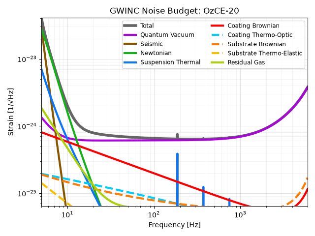

# OzCE-short

Noise and sensitivity modeling for an Australian, short‑baseline interferometer inspired by the Cosmic Explorer reference design.

## Proposed layout for this repo

- `ifo/`: project-specific YAML files, including a `canonical/` subdir for copies to upstream `pygwinc` IFOs and a `variant/` subdir for derived detectors
- `notebooks/`: Jupyter notebooks exploring parameter variations, sensitivity curves, and noise budgets (possibly each importing `pygwinc`)
- `scripts/`: command-line Python scripts to generate automated plots (more like a placeholder for now)
- `env/`: configuration files specifying dependencies (`pygwinc`, `finesse`,...)
- `docs/`: project documentation

## Installation tips

- Ensure that the *conda-forge* channel is available on your machine
- Clone this repository
- Create a project environment using `conda create -f OzCE-short/env/environment.yml`. This automatically generates a conda environment named *OzCE-short* and installs the required Python packages in that environment.
- Activate/select this Python environment and you are all set!

You can test your setup by running the following command inside the newly created Python environment.

```bash
gwinc ifo/variant/OzCE-20.yaml -t "GWINC Noise Budget: OzCE-20"
```

The plot below should pop up on the screen.

